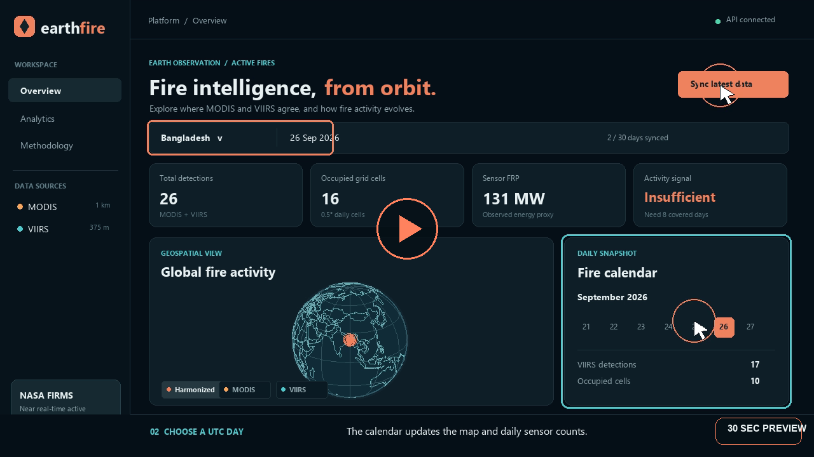

# EarthFire

EarthFire is a public NASA FIRMS explorer for comparing MODIS and VIIRS active-fire detections. [Open the live dashboard](https://earthfire.onrender.com/). Read the [detailed project and deployment guide](docs/PROJECT_DOCUMENTATION.md). It has a FastAPI/SQLite ingestion and analysis service, a React/Three.js dashboard, daily 0.5° spatial grid, statistical activity signal, and an optional LSTM next-day occupied-cell forecast.

The linked 2026 Space Apps challenge statement was unavailable when this project was created, so the implementation follows the architecture supplied in the request. Check the official challenge statement and participation rules before using this as a hackathon submission.

## Project layout

```text
backend/app/core.py     FIRMS ingestion, SQLite storage, daily grid and statistics
backend/app/main.py     FastAPI endpoints
backend/backfill.py     Historical FIRMS importer
backend/train_lstm.py  Optional TensorFlow/Keras forecast training
frontend/src/App.tsx    Dashboard controls, metrics, timeline, alerts and exports
frontend/src/Globe.tsx  Interactive 3D globe
frontend/src/style.css  Responsive dashboard styles
docs/earthfire-user-guide-60s.mp4  Silent, captioned one-minute user guide
docs/earthfire-preview-30s.mp4  30-second README preview clip
tools/create_user_guide_video.py  Rebuilds the guide, preview, captions, and poster
```

The local `.env`, installed dependencies and build output are excluded from Git. A snapshot of NASA FIRMS observations is committed at [`data/earthfire.sqlite3`](data/earthfire.sqlite3). The public repository includes `.env.example` instead of a live key.

## Watch the 30-second preview

Click the preview image to open the silent video, then open the [full one-minute walkthrough](docs/earthfire-user-guide-60s.mp4). It shows how to choose a region and date, read the calendar, compare sensor layers on the globe, and explore the activity trend and shared grid. The video has no voiceover; on-screen captions explain each step. A separate [WebVTT caption transcript](docs/earthfire-user-guide.vtt) is available.

[](docs/earthfire-preview-30s.mp4)

For the local experience, run the API and dashboard as described below, then open [the local preview](http://127.0.0.1:5173/).

To regenerate the videos, install Pillow and `imageio-ffmpeg`, then run `python tools/create_user_guide_video.py` from the repository root.

## Dashboard features

- **Play the fire timeline:** use the play button or slider under the globe to move through the UTC days currently loaded for the selected region or calendar month. Each step updates the selected day and its hotspot markers.
- **Inspect a hotspot:** select a globe marker to see its country, date, grid-cell coordinates, separate MODIS and VIIRS detection counts and FRP, plus occupied cell area and density. These are cell-level observations, not a confirmed fire perimeter or a confidence estimate.
- **Follow a region and receive alerts:** save one of the dashboard's named regions in this browser, then enable browser notifications. When the active region's FIRMS sync increases the current 30-day detection total, EarthFire sends at most one notification per region per day. The region list and notification permission are browser-local; alerts require the dashboard to be open for its sync to run.
- **Export data and charts:** download the loaded cell observations as CSV or save the current activity chart as SVG. The CSV contains aggregated grid-cell/day values, not raw NASA detection records.

## Public demo deployment

This repository includes a Render Blueprint and multi-stage Dockerfile for the public demo at [earthfire.onrender.com](https://earthfire.onrender.com/). The image builds the React/Vite frontend with Node.js, then installs and runs the FastAPI backend with Python. To deploy your own copy, connect the GitHub repository to Render as a Blueprint so it reads `render.yaml`; add `FIRMS_MAP_KEY` under the service's Environment settings if live FIRMS sync is needed; then use **Manual Deploy → Deploy latest commit**. The service currently uses manual deploys. The committed observation snapshot lets visitors explore without a key. The free service may sleep while idle, and this configuration has no persistent disk, so newly ingested SQLite data can be lost when the instance restarts. See [Render's free service limits](https://render.com/docs/free) before relying on live writes.

## Start

Requires Node.js 20+ and Python 3.11+.

1. Copy `.env.example` to `.env` and set `FIRMS_MAP_KEY` to your NASA FIRMS map key if you want to sync fresh data. The committed SQLite snapshot already provides observations to explore.
2. Install dependencies:

   ```powershell
   python -m venv .venv
   .\.venv\Scripts\python -m pip install -r backend\requirements.txt
   ```

3. Start the API in one terminal:

   ```powershell
   .\.venv\Scripts\python -m uvicorn backend.app.main:app --host 127.0.0.1 --port 8000 --reload
   ```

4. Install and start the dashboard from `frontend/` in a second terminal, then open http://127.0.0.1:5173:

   ```powershell
   Set-Location frontend
   npm install
   npm run dev
   ```

5. Click **Sync latest data**. The API fills missing coverage for the preceding 14 days, refreshes the latest 3 days from MODIS and VIIRS near-real-time sources, and saves the result in `data/earthfire.sqlite3`. Cached historical days are skipped. In the dashboard, use the calendar's month and year selectors to load older FIRMS history for the selected region.

API docs: http://127.0.0.1:8000/docs. `POST /api/ingest/recent` backfills recent coverage and refreshes the latest 3 days. `POST /api/history/month` loads a selected month using recent NRT or archived SP sources when available. `POST /api/ingest` accepts a bounding box, 1–5 day range, source list, and optional `start_date` for manual requests.

## Historical data and LSTM

FIRMS standard processing (SP) and near-real-time (NRT) have different date ranges. Check [FIRMS data availability](https://firms.modaps.eosdis.nasa.gov/api/data_availability/) before choosing a source. Download a modest region for a continuous interval:

```powershell
.\.venv\Scripts\python -m backend.backfill --bbox 88 20 93 27 --start 2026-07-01 --end 2026-08-31 --sources MODIS_NRT VIIRS_NOAA20_NRT
```

This script calls the FIRMS area API in 5-day chunks. Larger regions and longer periods consume more FIRMS transactions and storage. For an exploratory next-day forecast, use a Python 3.11–3.13 virtual environment, install TensorFlow, and train after at least 60 consecutive covered days, including at least 20 days with detections. The latest TensorFlow package supports CPU training on native Windows; GPU training requires another supported platform or WSL2.

```powershell
.\.venv\Scripts\python -m pip install -r backend\requirements-ml.txt
.\.venv\Scripts\python -m backend.train_lstm --bbox 88 20 93 27
```

The API and dashboard show the saved forecast when it was trained through the latest covered day and that day is recent. The activity level remains a separate statistical comparison; the LSTM predicts next-day occupied cells and reports holdout error.

## Harmonization and limits

- All acquisitions are assigned to UTC days and 0.5° latitude/longitude cells. The map plots cell centers, not exact fire perimeters.
- Raw MODIS and VIIRS counts and summed FRP remain separate. The harmonized count is **one occupied cell per UTC day** when either sensor has detections. This avoids directly equating a 1 km MODIS pixel with a 375 m VIIRS pixel.
- Cell density is reported as occupied cells per 1,000 km². A latitude-dependent spherical area calculation adjusts the size of each grid cell.
- Harmonized FRP is the larger of sensor-specific daily FRP sums in each cell. It is an exploratory proxy, **not** a calibrated or physically additive cross-sensor FRP.
- The statistical signal compares the latest complete UTC day with up to 14 previous days. It is an activity anomaly, **not** wildfire risk or probability. Sparse coverage, clouds, satellite overpass timing, and sensor outages can change the signal.
- The LSTM is optional and reports holdout mean absolute error. Its output is experimental and should not be used for emergency decisions.

Data source: [NASA FIRMS area API](https://firms.modaps.eosdis.nasa.gov/api/area/) and [FIRMS data documentation](https://firms.modaps.eosdis.nasa.gov/content/academy/data_api/firms_api_use.html).

The globe surface uses NASA Earth Observatory's [Blue Marble: Next Generation base map](https://science.nasa.gov/earth/earth-observatory/blue-marble-next-generation/base-map/) (January, 5400 × 2700 JPEG), included locally at `frontend/public/textures/earth-blue-marble.jpg`.
